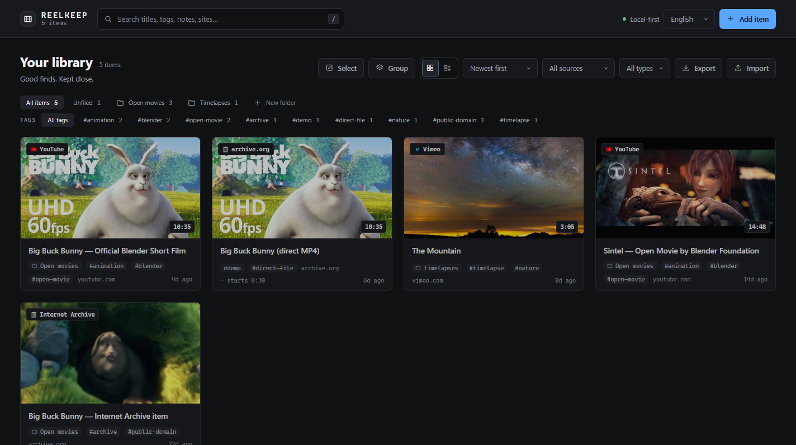
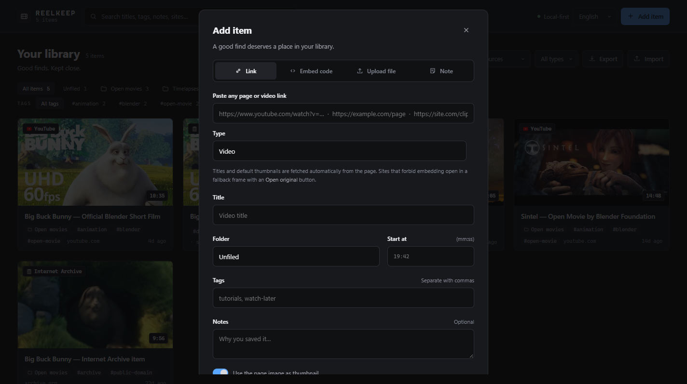
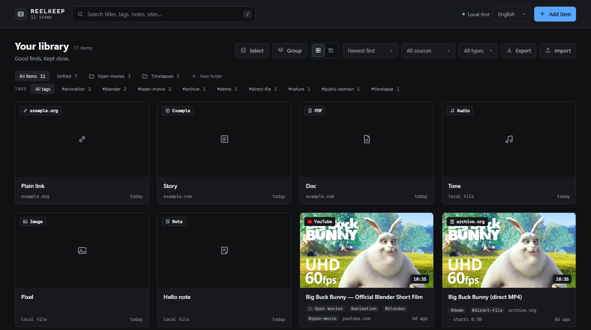
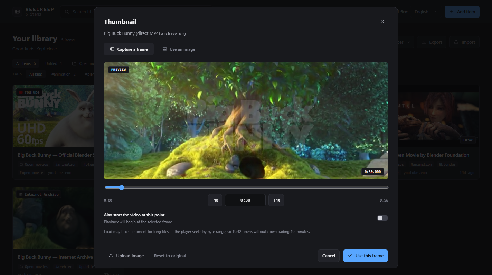
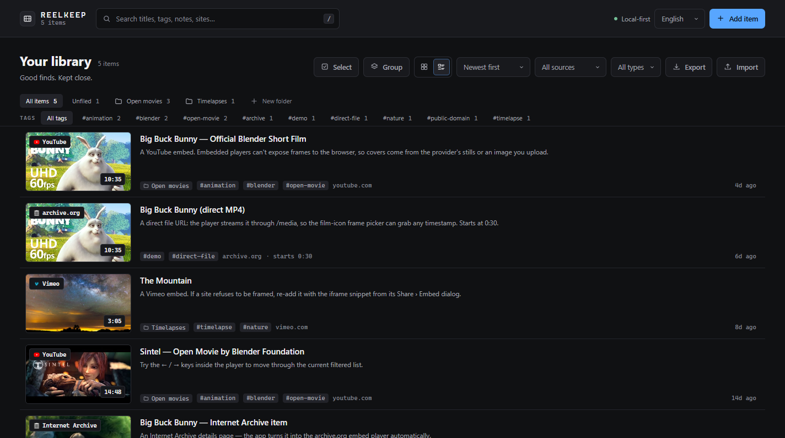
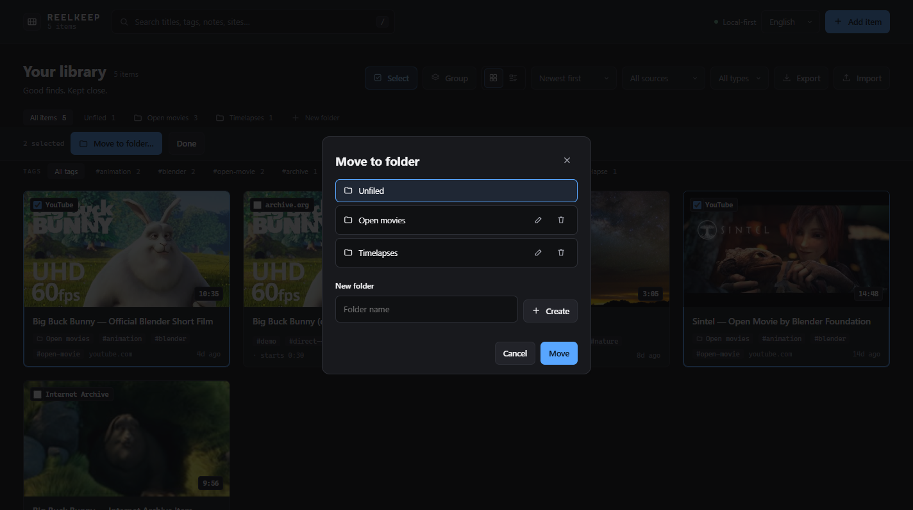
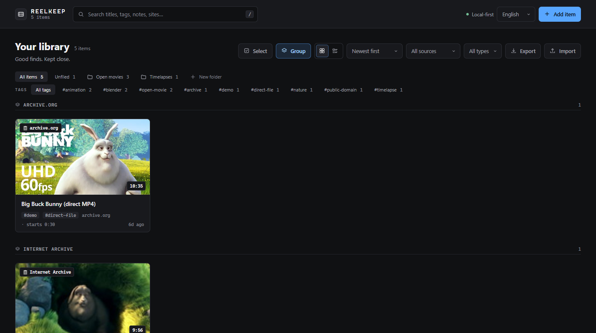
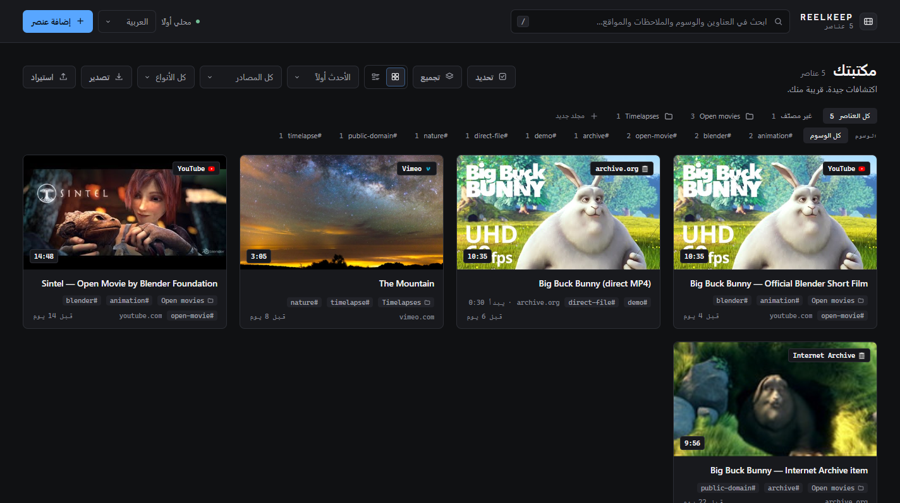

# ReelKeep

A local-first library for everything you want to keep — videos, articles, images,
audio, PDFs, notes and files. Paste **any** link, watch or read it in a unified
viewer, give it the cover you want, and keep everything in a plain JSON file.

[](LICENSE)
[](https://nodejs.org)
[](https://github.com/DeekX/ReelKeep/actions/workflows/ci.yml)
[](https://deekx.github.io/ReelKeep/)



**No build step, no `npm install`, no database.** One dependency-free Node server
plus vanilla HTML/CSS/JS — clone it and run.

**Try it without installing:** <https://deekx.github.io/ReelKeep/> — a browser-only
demo seeded with the example library. Edits stay in your browser; uploads, the JSON
file and frame-accurate thumbnails need the local server below.

## Quickstart

Requires Node 18+ on Windows, macOS or Linux. Any evergreen browser works.

```sh
node server.js        # or: npm start
```

Then open **http://127.0.0.1:5178**. The first run seeds a small example library
(Blender open movies, a Vimeo timelapse, an Internet Archive item) so you can try
everything immediately — delete the entries or edit `data/library.json` to make it yours.
An existing `data/videos.json` from an older version is migrated automatically
(with a backup in `backups/`) and left in place.

| Want | Windows (cmd) | macOS / Linux |
| --- | --- | --- |
| A different port | `set PORT=8080 && node server.js` | `PORT=8080 node server.js` |
| Open to the LAN | `set HOST=0.0.0.0 && node server.js` | `HOST=0.0.0.0 node server.js` |
| Stop the server | `Ctrl+C` in that window | `Ctrl+C` in that window |

PowerShell uses `$env:PORT=8080; node server.js`. Read [SECURITY.md](SECURITY.md)
before enabling LAN mode.

**Browser-only mode:** served from any static host without the API (like the live
demo), the app keeps your library in browser storage (footer says *browser storage
only*) — no JSON file, no uploads, no automatic page titles. Run the server for the
full experience. One honest limit: the UI is ES modules, which browsers refuse to
load from `file://`, so double-clicking `index.html` no longer boots it — use the
demo, any static server, or `node server.js`.

## Adding items — four ways

The add dialog detects the type from what you paste or drop, and lets you override it.

1. **Link** — paste a URL from almost anywhere. The app recognises YouTube, Vimeo,
   Dailymotion, Twitch, TikTok, X/Twitter, Facebook, Instagram, Loom, Wistia,
   Streamable, Rutube and Internet Archive, and turns the link into a proper player URL.
   For any *other* site it reads the page's own metadata (title, description, cover)
   and saves it as an article; a link ending in `.mp4`, `.mp3`, `.png`, `.pdf`, …
   becomes the matching media type.
2. **Embed code** — paste the `<iframe …>` snippet from a site's *Share → Embed* dialog;
   the player URL is extracted from it. Use this when a site refuses to be framed.
3. **Upload a file** — pick any file, or **drag and drop it anywhere on the page**.
   Videos land in `videos/`, everything else in `files/`, served by your own server.
4. **Note** — write Markdown inside the app (headings, emphasis, lists, links, code,
   quotes). Rendered by DOM construction, never as raw HTML.



## Everything, not just video



| Type | Viewer |
| --- | --- |
| Video | unified player: provider embeds, direct files, frame-accurate covers, start times |
| Article / link | metadata reader; opt-in **reader copy** stored locally (text only, sanitized) |
| Image | zoom & pan viewer; the image is its own cover |
| Audio | built-in player with 0.5–2× speed and remembered position |
| PDF | the browser's viewer in a sandboxed frame |
| Note | Markdown preview + editor |
| File | icon, size, MIME, SHA-256; download or open |

Every type shares one card system, one search index, folders, tags, drag & drop,
and the type filter next to the source filter. **Resume** is offered (never forced)
for video and audio; the explicit *start at* point stays untouched.

**Export / Import** (toolbar): full-fidelity JSON of the whole library. Import
previews counts and duplicates, skips what you already have, and is undoable.
In browser-only mode small stored files are inlined into the export so it
round-trips alone; larger bundles belong to server mode, where `files/` and
`thumbnails/` sit next to `library.json` on disk.

## Covers and frame-accurate thumbnails

Every card shows a default cover first: the page's own image (`og:image`, copied into
`thumbnails/` so it can't break later), or the provider's standard thumbnail, or — for a
video file — the opening frame, captured automatically.

To pick a specific frame: open the video (or the card's edit dialog) → **film icon** →
type a timestamp such as `19:42`, or drag the scrub bar, then **Use this frame**. Tick
*Also start the video at this point* to make that moment the playback start.



**One honest limitation:** a browser can only read pixels from video it can access
same-origin. That works for uploaded files and for direct `.mp4`/`.webm` links (the app
streams those through its own `/media` proxy). It is *not* possible for YouTube, Vimeo and
other embedded players — those pages forbid cross-origin frame reads, so for them you get
the provider's standard frames, an uploaded image, or an image URL. The player still
honours "start at 19:42" for those, so you can see the frame you want.

## Player and library features


- **Search** (`/` to focus) across titles, tags, notes, sites and URLs, with matches highlighted.
- **Two layouts**: a thumbnail **grid** or a full-width **list** (bigger titles, notes shown, one row per video). Toggle with the icons at the top right or press `V`; your choice is remembered.
- **Rename** by double-clicking a card title, or in the edit dialog. Same for the title inside the player.
- **Tags** with clickable filter chips, plus a source filter and sort options.
- **Expand**: *fit to screen* hides the chrome around the player (move the mouse to bring it back), and *fullscreen* (`F`) uses the real browser fullscreen.
- **Playlist-ish navigation**: `←` / `→` in the player move through the current filtered list.
- **Folders**: group videos into named folders, move them by drag & drop or multi-select, filter by folder.
- **Group by source**: one toggle clusters the gallery into labelled per-source sections.
- **Delete** with a confirmation step.



## Folders and source grouping



The bar under the toolbar holds **All videos**, **Unfiled** and your folders, each with a
live count. **New folder** creates one; double-click a folder chip to rename it. Opening a
folder reveals its action bar: **Empty folder** (moves every video inside out to *Unfiled*,
keeping the folder), **Rename**, and **Delete folder** — deleting removes the folder *and
the videos inside it*, and the confirmation states exactly how many. Uploaded files on
disk are never touched.

Two ways to move videos:

- **Drag & drop** — drag a card onto a folder chip (or onto *Unfiled*). While you drag,
  every folder chip outlines itself as a target and the one under your cursor highlights.
  In selection mode, dragging a selected card moves the whole selection.
- **Select and move** — the check-square button in the toolbar enters selection mode; click
  cards (or their checkboxes), then **Move to folder…**. The dialog also creates, renames
  and deletes folders. `Esc` or **Done** leaves selection mode.

Each video lives in at most one folder; cards in the *All videos* view show a small folder
badge so you always know where something lives.



The layers button (or `G`) switches on **group by source**: the current filtered list is
clustered into sections — YouTube, Vimeo, archive.org, … — each with a count. It composes
with folder filters, tag filters, search and both layouts, and the choice is remembered.

### Keyboard shortcuts

| Key | Where | Action |
| --- | --- | --- |
| `/` | gallery | focus search |
| `N` | gallery | add a video |
| `V` | gallery | switch grid / list |
| `G` | gallery | group by source on / off |
| `Esc` | selection mode | leave selection mode |
| drag card → folder chip | gallery | move video (or whole selection) into folder |
| `Enter` | focused card | open the player |
| double-click | card or player title | rename |
| `←` / `→` | player | previous / next video in the current filter |
| `F` | player | fullscreen |
| `Esc` | player / dialogs | close |
| `K` / `F` | built-in file player | play-pause / fullscreen |

## Where things live

```
data/library.json        your library — plain JSON, safe to edit or version-control
data/videos.json         legacy library (v1): read and migrated, never deleted
data/videos.example.json starter library copied on first run
backups/                 automatic backups before migrations and risky writes
thumbnails/              covers the app generated or copied
videos/                  files you uploaded
files/                   other uploaded files (later phases)
server.js + lib/         static server + universal store + metadata reader + media proxy
index.html               the gallery UI
player.html              the in-iframe player used for video files
app.js + js/             ES-module app: core, storage, handlers, views, dialogs
styles.css               the visual layer (screening-room identity)
i18n.js                  11 language dictionaries + translation runtime
test/                    zero-dependency suites (npm test)
scripts/                 dev tools: syntax check, README screenshots
docs/                    architecture, data format, API reference, screenshots
```

`library.json` is written atomically (temp file + rename), so a crash mid-save cannot
truncate your library. See [docs/data-format.md](docs/data-format.md) for the schema
and [docs/architecture.md](docs/architecture.md) for the module layout.

`.gitignore` keeps `data/library.json`, `data/videos.json`, `backups/`, `videos/`,
`files/` and `thumbnails/` out of git — pushing this repo never publishes your personal
library or media. The HTTP server likewise only serves the UI files and your media
folders; the library JSON and repo internals are never reachable over the network.

## Development

```sh
npm test              # node:test suites — no dependencies to install
npm run check         # syntax-check every script (also runs in CI)
npm run screenshot    # refresh docs/screenshot-*.png (Node 22+, Chrome installed)
```

CI runs the suite on Linux, macOS and Windows against Node 18, 20 and 22.
See [CONTRIBUTING.md](CONTRIBUTING.md) for the ground rules (zero dependencies,
plain JSON, loopback by default), [docs/api.md](docs/api.md) for the HTTP API
and the video record schema, and [CHANGELOG.md](CHANGELOG.md) for release history.
Planning visual work? [docs/ui-brief.md](docs/ui-brief.md) is the design handoff:
every surface, the token set, and the JS/i18n/RTL contracts a redesign must preserve.

## Languages

The interface ships in 11 languages: English (default), Arabic, Russian, French, German,
Spanish, Simplified Chinese, Japanese, Korean, Hindi and Turkish. Pick yours from the
language selector in the toolbar; the choice is remembered, and a first visit follows your
browser's language. Arabic switches the entire layout to right-to-left.



Translations live in `i18n.js` — one dictionary per language, with `{placeholder}`
variables. To add a language: copy the `en` block, translate it, and register it in
`I18N_META` plus the toolbar selector. Server log lines and provider brand names stay
untranslated by design.

## Troubleshooting

| Symptom | Cause / fix |
| --- | --- |
| Player area is blank | That site forbids embedding (`X-Frame-Options`/CSP). Use **Open original**, or re-add it with its embed code. |
| "Could not read that page: 403" | The site blocks metadata readers. Type a title yourself; the player usually still works. |
| No frames to pick from | Expected for embedded players (see the limitation above). Upload an image instead. |
| Long file loads slowly in the picker | Seeking streams by byte range, so it starts at the requested moment rather than downloading the whole file — but the first seek on a remote host still needs a round trip. |
| Port already in use | `set PORT=8080 && node server.js` (Windows) or `PORT=8080 node server.js` (macOS/Linux) |

## Notes

- The server binds to `127.0.0.1` only, so nothing here is exposed to your network by default.
- `/media` and `/api/enrich` fetch remote URLs on request — intended for personal use on a
  loopback-bound server, not for public hosting. See [SECURITY.md](SECURITY.md).
- Iframes are loaded without a sandbox so that real players (YouTube, Vimeo, …) function;
  only add links you trust.
- Deleting an entry removes its stored cover, never your uploaded video file.

## License

[MIT](LICENSE) © DEEK
