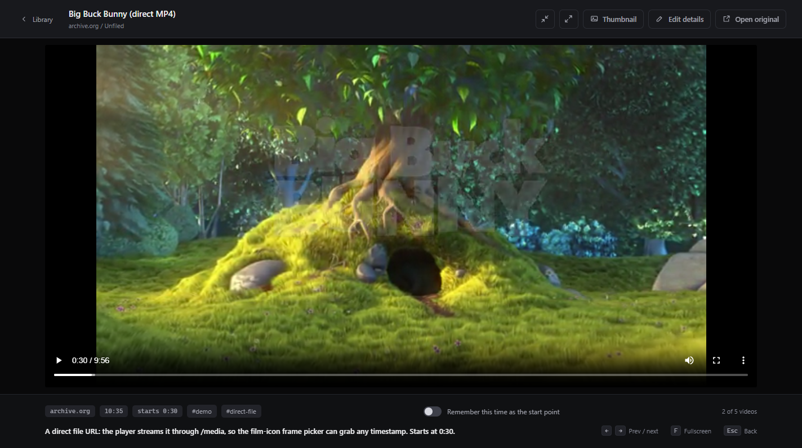

# Reelkeep

A local-first video library. Paste **any** video link, watch it in a unified player,
give it the cover you want, and keep everything in a plain JSON file.

[](LICENSE)
[](https://nodejs.org)
[](https://github.com/DeekX/reelkeep/actions/workflows/ci.yml)
[](https://deekx.github.io/reelkeep/)


**No build step, no `npm install`, no database.** One dependency-free Node server
plus vanilla HTML/CSS/JS — clone it and run.

**Try it without installing:** <https://deekx.github.io/reelkeep/> — a browser-only
demo seeded with the example library. Edits stay in your browser; uploads, the JSON
file and frame-accurate thumbnails need the local server below.

## Quickstart

Requires Node 18+ on Windows, macOS or Linux. Any evergreen browser works.

```sh
node server.js        # or: npm start
```

Then open **http://127.0.0.1:5178**. The first run seeds a small example library
(Blender open movies, a Vimeo timelapse, an Internet Archive item) so you can try
everything immediately — delete the entries or edit `data/videos.json` to make it yours.

| Want | Windows (cmd) | macOS / Linux |
| --- | --- | --- |
| A different port | `set PORT=8080 && node server.js` | `PORT=8080 node server.js` |
| Open to the LAN | `set HOST=0.0.0.0 && node server.js` | `HOST=0.0.0.0 node server.js` |
| Stop the server | `Ctrl+C` in that window | `Ctrl+C` in that window |

PowerShell uses `$env:PORT=8080; node server.js`. Read [SECURITY.md](SECURITY.md)
before enabling LAN mode.

If you open `index.html` by double-clicking it instead, the page still works, but it
falls back to browser storage (footer says *browser storage only*) — no JSON file, no
uploads, no automatic page titles. Run the server for the full experience.

## Adding videos — four ways

1. **Link** — paste a URL from almost anywhere. The app recognises YouTube, Vimeo,
   Dailymotion, Twitch, TikTok, X/Twitter, Facebook, Instagram, Loom, Wistia,
   Streamable, Rutube and Internet Archive, and turns the link into a proper player URL.
   For any *other* site it reads the page's own metadata to get the title, the default
   cover image and, when the site exposes one, a direct video file.
2. **Embed code** — paste the `<iframe …>` snippet from a site's *Share → Embed* dialog;
   the player URL is extracted from it. Use this when a site refuses to be framed.
3. **Upload a file** — pick a video, or **drag and drop it anywhere on the page**. It is
   stored in `videos/` and served locally.
4. **Direct file URL** — a link ending in `.mp4`, `.webm`, `.mov`, … plays directly.

## Covers and frame-accurate thumbnails

Every card shows a default cover first: the page's own image (`og:image`, copied into
`thumbnails/` so it can't break later), or the provider's standard thumbnail, or — for a
video file — the opening frame, captured automatically.

To pick a specific frame: open the video (or the card's edit dialog) → **film icon** →
type a timestamp such as `19:42`, or drag the scrub bar, then **Use this frame**. Tick
*Also start the video at this point* to make that moment the playback start.


**One honest limitation:** a browser can only read pixels from video it can access
same-origin. That works for uploaded files and for direct `.mp4`/`.webm` links (the app
streams those through its own `/media` proxy). It is *not* possible for YouTube, Vimeo and
other embedded players — those pages forbid cross-origin frame reads, so for them you get
the provider's standard frames, an uploaded image, or an image URL. The player still
honours "start at 19:42" for those, so you can see the frame you want.

## Player and library features



- **Search** (`/` to focus) across titles, tags, notes, sites and URLs, with matches highlighted.
- **Two layouts**: a thumbnail **grid** or a full-width **list** (bigger titles, notes shown, one row per video). Toggle with the icons at the top right or press `V`; your choice is remembered.
- **Rename** by double-clicking a card title, or in the edit dialog. Same for the title inside the player.
- **Tags** with clickable filter chips, plus a source filter and sort options.
- **Expand**: *fit to screen* hides the chrome around the player (move the mouse to bring it back), and *fullscreen* (`F`) uses the real browser fullscreen.
- **Playlist-ish navigation**: `←` / `→` in the player move through the current filtered list.
- **Delete** with a confirmation step.

### Keyboard shortcuts

| Key | Where | Action |
| --- | --- | --- |
| `/` | gallery | focus search |
| `N` | gallery | add a video |
| `V` | gallery | switch grid / list |
| `Enter` | focused card | open the player |
| double-click | card or player title | rename |
| `←` / `→` | player | previous / next video in the current filter |
| `F` | player | fullscreen |
| `Esc` | player / dialogs | close |
| `K` / `F` | built-in file player | play-pause / fullscreen |

## Where things live

```
data/videos.json         your library — plain JSON, safe to edit or version-control
data/videos.example.json starter library copied on first run
thumbnails/              covers the app generated or copied
videos/                  files you uploaded
server.js                static server + JSON store + metadata reader + media proxy
index.html               the gallery UI
player.html              the in-iframe player used for video files
app.js / styles.css      gallery logic and styling
test/server.test.js      zero-dependency smoke suite (npm test)
scripts/screenshot.mjs   dev tool: refresh the README screenshots
docs/                    screenshots and API reference
```

`videos.json` is written atomically (temp file + rename), so a crash mid-save cannot
truncate your library.

`.gitignore` keeps `data/videos.json`, `videos/` and `thumbnails/` out of git — pushing
this repo never publishes your personal library or media. The HTTP server likewise only
serves the UI files and your media folders; the library JSON and repo internals are
never reachable over the network.

## Development

```sh
npm test              # node:test smoke suite — no dependencies to install
npm run screenshot    # refresh docs/screenshot-*.png (Node 22+, Chrome installed)
```

CI runs the suite on Linux, macOS and Windows against Node 18, 20 and 22.
See [CONTRIBUTING.md](CONTRIBUTING.md) for the ground rules (zero dependencies,
plain JSON, loopback by default), [docs/api.md](docs/api.md) for the HTTP API
and the video record schema, and [CHANGELOG.md](CHANGELOG.md) for release history.

## Troubleshooting

| Symptom | Cause / fix |
| --- | --- |
| Player area is blank | That site forbids embedding (`X-Frame-Options`/CSP). Use **Open original**, or re-add it with its embed code. |
| "Could not read that page: 403" | The site blocks metadata readers. Type a title yourself; the player usually still works. |
| No frames to pick from | Expected for embedded players (see the limitation above). Upload an image instead. |
| Long file loads slowly in the picker | Seeking streams by byte range, so it starts at the requested moment rather than downloading the whole file — but the first seek on a remote host still needs a round trip. |
| Port already in use | `set PORT=8080 && node server.js` (Windows) or `PORT=8080 node server.js` (macOS/Linux) |

## Notes

- The server binds to `127.0.0.1` only, so nothing here is exposed to your network by default.
- `/media` and `/api/enrich` fetch remote URLs on request — intended for personal use on a
  loopback-bound server, not for public hosting. See [SECURITY.md](SECURITY.md).
- Iframes are loaded without a sandbox so that real players (YouTube, Vimeo, …) function;
  only add links you trust.
- Deleting an entry removes its stored cover, never your uploaded video file.

## License

[MIT](LICENSE) © DEEK
